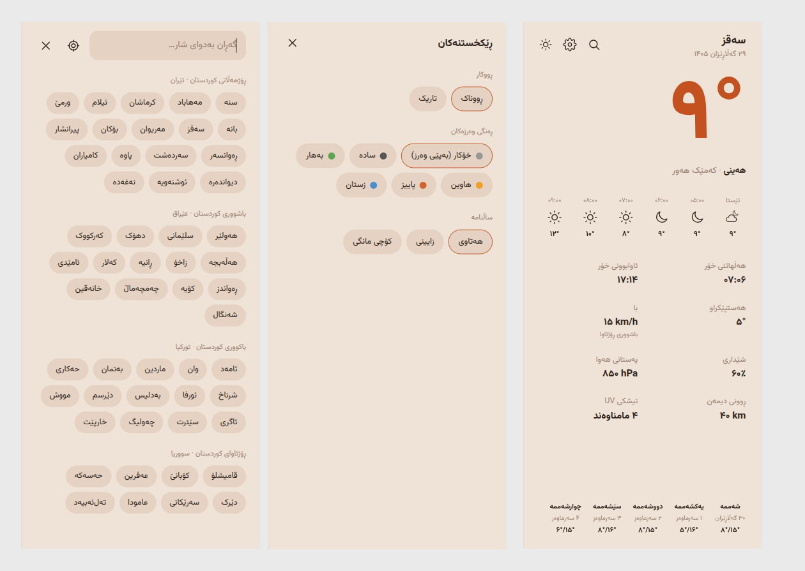

<p align="center">
  
</p>


# کەشوهەوای کوردستان — Kurdistan Weather

ئەپێکی وێب (PWA) بۆ بینینی دۆخی کەشوهەوای شارەکانی کوردستان لە ئێران، عێراق، تورکیا و سووریا. ڕووکارەکەی تەواو بە **کوردی سۆرانی** و ڕاست‌بۆ‌چەپە، دیزاینەکەی ساکار و کەمینیمالە و دوو ڕووکاری ڕووناک و تاریکی هەیە.



## تایبەتمەندییەکان

- پلەی گەرمیی ئێستا بە ژمارەیەکی گەورە، و ناوی ڕۆژی هەفتە لە ژێرییەوە
- بەروار لە سەرەوە بە **ساڵنامەی هەتاوی و مانگە کوردییەکان** (خاکەلێوە، گوڵان، جۆزەردان، پووشپەڕ، خەرمانان، گەلاوێژ، ڕەزبەر، گەڵاڕێزان، سەرماوەز، بەفرانبار، ڕێبەندان، ڕەشەمە)
- پێشبینی کاتژمێر بە کاتژمێر بۆ ٢٤ کاتژمێری داهاتوو
- وردەکاری: هەڵهاتن و ئاوابوونی خۆر، پلەی هەستپێکراو، با و ئاراستەکەی، شێداری، پەستانی هەوا، ڕوونی دیمەن، تیشکی UV
- پێشبینی ١٠ ڕۆژی داهاتوو (کەمترین/زۆرترین پلەی گەرمی)
- **گەڕان بەدوای شار** بە کوردی یان ئینگلیزی
- شارە ئامادەکراوەکان لە چوار بەشدا: ڕۆژهەڵات (ئێران)، باشوور (عێراق)، باکوور (تورکیا)، ڕۆژئاوا (سووریا)
- دوگمەی «شوێنی من» بۆ بەکارهێنانی شوێنی ئامێرەکە
- ڕووکاری ڕووناک و تاریک و لەبیرکردنی دوایین شاری هەڵبژێردراو
- **ڕێکخستنەکان** (دوگمەی چەرخ لە تەنیشت گەڕان): ڕەنگی وەرزەکان (بەهار، هاوین، پاییز، زستان، یان خۆکار بەپێی وەرزی ئێستا)، و گۆڕینی ساڵنامە لە نێوان هەتاوی، زایینی و کۆچی مانگی
- ناوی ڕۆژەکانی هەفتە لە سەرووی بەرواری هەر یەک لە ١٠ ڕۆژی داهاتوودا
- دەکرێت لەسەر شاشەی سەرەکیی مۆبایل دابمەزرێت (PWA)، گونجاوە بۆ iPhone و Android

## پێکهاتەی فایلەکان

```
index.html            هەموو ئەپەکە (HTML + CSS + JS)
manifest.webmanifest  ڕێکخستنەکانی PWA
sw.js                 Service Worker بۆ کاشکردنی فایلەکانی ئەپ
icon-180.png          ئایکۆنی iOS
icon-192.png
icon-512.png
```

پێویستت بە build، npm یان سێرڤەری باکئێند نییە.

## کارپێکردن لەسەر کۆمپیوتەرەکەت

لەبەر ئەوەی Service Worker تەنیا لەسەر `http(s)` کار دەکات، فایلەکان بە سێرڤەرێکی ساکار بخەرە کار:

```bash
python3 -m http.server 8080
```

دواتر `http://localhost:8080` بکەرەوە.

## بڵاوکردنەوە

### GitHub Pages
1. فایلەکان لە ڕیپۆزیتۆرییەکدا دابنێ.
2. لە **Settings ← Pages** لقی `main` و بوخچەی root هەڵبژێرە.
3. دوای چەند خولەک ناونیشانی ماڵپەڕەکە چالاک دەبێت.

### Vercel
ڕیپۆزیتۆرییەکە لە Vercel هاوردە (Import) بکە. چونکە پڕۆژەکە ستاتیکە، ڕێکخستنی تایبەت پێویست نییە (Framework Preset: Other).

## دامەزراندن لەسەر iPhone

1. ناونیشانی ماڵپەڕەکە لە **Safari** بکەرەوە.
2. دوگمەی **Share** دابگرە.
3. **Add to Home Screen** هەڵبژێرە.

## زیادکردن یان دەستکاریکردنی شارەکان

شارە ئامادەکراوەکان لە ڕیزبەندی `PRESETS`ـی ناو `index.html`ـدان. هەر شارێک یەک دێڕە:

```js
P('سنە', 'Sanandaj', 35.3219, 46.9862, 'ir')
//  ناوی کوردی، ناوی ئینگلیزی، هێڵی پانی، هێڵی درێژی، بەش
```

کۆدی بەشەکان: `ir` ڕۆژهەڵات، `iq` باشوور، `tr` باکوور، `sy` ڕۆژئاوا.

ئەو شارانەی لە لیستەکەدا نین، لە ڕێگەی گەڕانەوە دەدۆزرێنەوە، بەو مەرجەی لە یەکێک لەو چوار وڵاتەدا بن.

## سەرچاوەی داتا

داتای کەشوهەوا و گەڕانی شار لە [Open-Meteo](https://open-meteo.com/) وەردەگیرێت (پێویستی بە کلیلی API نییە). داتای Open-Meteo لەژێر مۆڵەتی [CC BY 4.0](https://creativecommons.org/licenses/by/4.0/)ـدایە و بۆ بەکارهێنانی نابازرگانی بێبەرامبەرە. ئەگەر بۆ مەبەستی بازرگانی بەکاری دەهێنیت، مەرجەکانی ئەو خزمەتگوزارییە بپشکنە.


