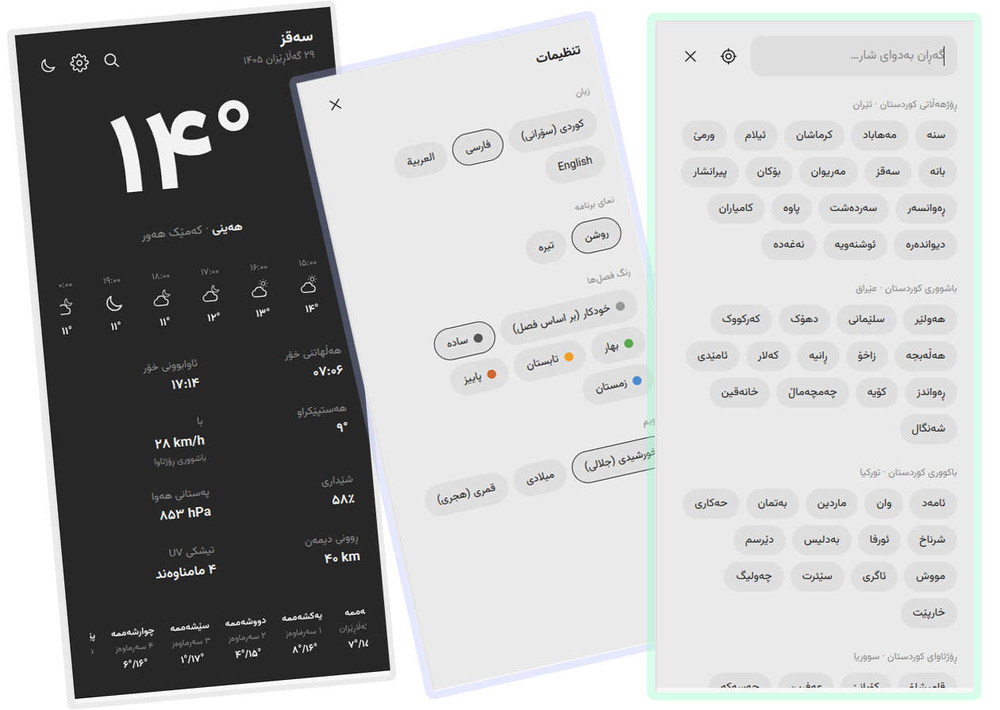
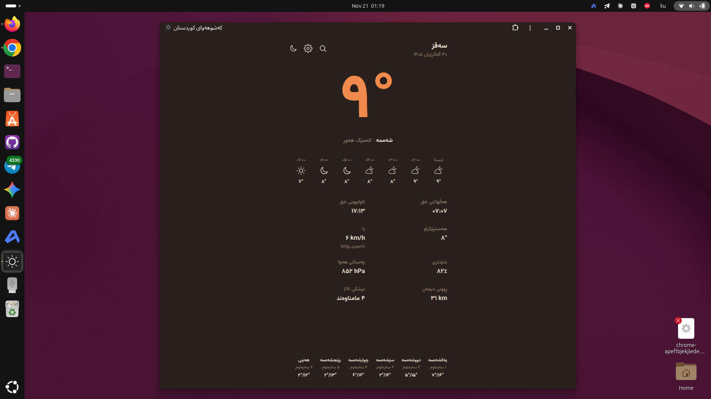

<p align="center">
  
</p>


# کەشوهەوای کوردستان — Kurdistan Weather

ئەپێکی وێب (PWA) بۆ بینینی دۆخی کەشوهەوای شارەکانی کوردستان لە ئێران، عێراق، تورکیا و سووریا. دیزاینەکەی ساکار و کەمینیمالە، دوو ڕووکاری ڕووناک و تاریکی هەیە، و بە **چوار زمان** کار دەکات: کوردی (سۆرانی)، فارسی، عەرەبی و ئینگلیزی.




## تایبەتمەندییەکان

- پلەی گەرمیی ئێستا بە ژمارەیەکی گەورە لە ناوەڕاستی شاشە، و ناوی ڕۆژی هەفتە لە ژێرییەوە
- **چوار زمان** (لە ڕێکخستنەکان): کوردی، فارسی، عەرەبی، ئینگلیزی. بە گۆڕینی زمان هەموو دەقەکان، ناوی شارەکان، ناوی ڕۆژەکان و مانگەکان، ژمارەکان، ئاراستەی نووسین (ڕاست‌بۆ‌چەپ یان چەپ‌بۆ‌ڕاست) و بەروار دەگۆڕێن
- **بەرواری هەر زمانێک:**
  - کوردی: ساڵنامەی هەتاوی بە مانگە کوردییەکان (خاکەلێوە، گوڵان، جۆزەردان...)
  - فارسی: ساڵنامەی خورشیدی بە مانگە فارسییەکان (فروردین، اردیبهشت...)
  - عەرەبی: ساڵنامەی زایینی بە ناوی مانگە عەرەبییەکانی عێراق و سووریا (كانون الثاني، شباط، آذار...)
  - ئینگلیزی: ساڵنامەی زایینی (January, February...)
- ساڵنامە لە ڕێکخستنەکان دەگۆڕدرێت: هەتاوی، زایینی یان کۆچی مانگی، بە ناوی مانگەکانی هەمان زمان
- پێشبینی کاتژمێر بە کاتژمێر بۆ ٢٤ کاتژمێری داهاتوو
- وردەکاری: هەڵهاتن و ئاوابوونی خۆر، پلەی هەستپێکراو، با و ئاراستەکەی، شێداری، پەستانی هەوا، ڕوونی دیمەن، تیشکی UV
- پێشبینی ١٠ ڕۆژی داهاتوو، لەگەڵ ناوی ڕۆژی هەفتە لە سەرووی بەرواری هەر ڕۆژێک
- **ڕەنگی وەرزەکان:** بەهار، هاوین، پاییز، زستان، سادە، یان خۆکار (بەپێی وەرزی ئێستا)
- **گەڕان بەدوای شار** بە هەر چوار زمانەکە، و شارە ئامادەکراوەکان لە چوار بەشدا: ڕۆژهەڵات (ئێران)، باشوور (عێراق)، باکوور (تورکیا)، ڕۆژئاوا (سووریا)
- دوگمەی «شوێنی من» بۆ بەکارهێنانی شوێنی ئامێرەکە
- ڕێکخستنەکان و دوایین شار هەڵدەگیرێن
- دەکرێت لەسەر شاشەی سەرەکیی مۆبایل دابمەزرێت (PWA)، گونجاوە بۆ iPhone و Android

## فۆنت

ئەپەکە فۆنتی **Vazirmatn** بەکاردەهێنێت. بە شێوەی خۆکار لە Google Fonts دابەزێت و دوای یەکەم جار لە کاشدا دەمێنێتەوە.

بۆ ئەوەی فۆنتەکە بێ ئینتەرنێتیش و بێ پشت‌بەستن بە Google کار بکات، فایلی فۆنتەکە لە ناو پڕۆژەکەدا دابنێ:

```bash
npm i vazirmatn
mkdir -p fonts
cp node_modules/vazirmatn/fonts/webfonts/Vazirmatn\[wght\].woff2 fonts/Vazirmatn-Variable.woff2
```

ئەپەکە خۆی ئەو فایلە بەکاردەهێنێت ئەگەر هەبێت.



## پێکهاتەی فایلەکان

```
index.html            هەموو ئەپەکە (HTML + CSS + JS)
manifest.webmanifest  ڕێکخستنەکانی PWA
sw.js                 Service Worker بۆ کاشکردنی فایلەکان و فۆنت
icon-180.png          ئایکۆنی iOS
icon-192.png
icon-512.png
fonts/                (ئارەزوومەندانە) Vazirmatn-Variable.woff2
```

پێویستت بە build، npm یان سێرڤەری باکئێند نییە.

## کارپێکردن لەسەر کۆمپیوتەرەکەت

لەبەر ئەوەی Service Worker تەنیا لەسەر `http(s)` کار دەکات، فایلەکان بە سێرڤەرێکی ساکار بخەرە کار:

```bash
python3 -m http.server 8080
```

دواتر `http://localhost:8080` بکەرەوە.


## دامەزراندن لەسەر iPhone

1. ناونیشانی ماڵپەڕەکە لە **Safari** بکەرەوە.
2. دوگمەی **Share** دابگرە.
3. **Add to Home Screen** هەڵبژێرە.

## زیادکردن یان دەستکاریکردنی شارەکان

شارە ئامادەکراوەکان لە ڕیزبەندی `PRESETS`ـی ناو `index.html`ـدان. هەر شارێک یەک دێڕە:

```js
P('سنە', 'Sanandaj', 35.3219, 46.9862, 'ir')
//  ناوی کوردی، ناوی ئینگلیزی، هێڵی پانی، هێڵی درێژی، بەش
```

کۆدی بەشەکان: `ir` ڕۆژهەڵات، `iq` باشوور، `tr` باکوور، `sy` ڕۆژئاوا.

ناوی فارسی و عەرەبیی هەر شارێک لە ڕیزبەندی `NAMES` دایە، بە ناوی ئینگلیزی وەک کلیل:

```js
Sanandaj: ['سنندج', 'سنندج']   // [فارسی, عەرەبی]
```

شارەکانی تر لە ڕێگەی گەڕانەوە دەدۆزرێنەوە، بەو مەرجەی لە یەکێک لەو چوار وڵاتەدا بن.

## زیادکردنی زمانێکی نوێ

لە `index.html` شوێنی `LANGS` ببینە. هەر زمانێک ئۆبجێکتێکە لە دەقەکان، ناوی مانگەکان (هەتاوی، زایینی، کۆچی)، ناوی ڕۆژەکان، ئاراستەی با، دۆخی کەشوهەوا و ناوی بەشەکان. ئۆبجێکتێکی نوێ لەسەر هەمان شێوە زیاد بکە.

## سەرچاوەی داتا

داتای کەشوهەوا و گەڕانی شار لە [Open-Meteo](https://open-meteo.com/) وەردەگیرێت (پێویستی بە کلیلی API نییە). داتای Open-Meteo لەژێر مۆڵەتی [CC BY 4.0](https://creativecommons.org/licenses/by/4.0/)ـدایە و بۆ بەکارهێنانی نابازرگانی بێبەرامبەرە. ئەگەر بۆ مەبەستی بازرگانی بەکاری دەهێنیت، مەرجەکانی ئەو خزمەتگوزارییە بپشکنە.

فۆنتی [Vazirmatn](https://github.com/rastikerdar/vazirmatn) لەژێر مۆڵەتی SIL OFL 1.1 دایە.


